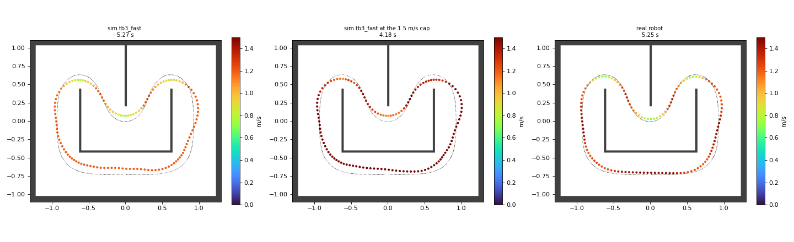

# Session 2026-11-09: which Nav2 mode laps best

Branch `optimised`. All measurements: Gazebo GUI, Fibonacci arena, `robot:=tb3_fast`, ground truth from Gazebo.
Laps, failures and stalls are counted over the 95 s after `Fast mode` (one run per row; single runs vary).

## 1. Answer

**Regulated Pure Pursuit + Theta\*** (`planner:=thetastar`) and, after its tuning, **MPPI for the race with RPP for
the mapping lap** (`controller:=mppi`) are the fastest at 1.2 m/s: 8 laps each, laps of ~11–12.5 s. MPPI is the
steadiest (never stopped, 0.1–0.2 % of the time inside the 0.13 m wall margin vs 0.8 % for RPP + Theta\*).
**RPP + NavFn** (the default) is the safest at 0.6 m/s: no collision stalls and never closer than 0.17 m to a wall.
Graceful is much slower.

| Controller + planner | 1.2 m/s: laps (times, s) | failed | stalls | wall < 0.15 m | 0.6 m/s: laps (times, s) | failed | stalls | wall < 0.15 m |
|---|---|---|---|---|---|---|---|---|
| **RPP + Theta\*** | **8** (16.5, 11.7, 12.5, 11.8, 11.9, 12.2, 13.4, 11.1) | 0 | 37 | 2.2 % | **6** (19.8, 15.4, 15.2, 16.3, 19.3, 15.8) | 0 | 63 | 7.5 % |
| RPP + NavFn | 6 (17.1, 12.8, 13.3, 11.8, 13.9, 12.2) | 0 | 32 | 1.4 % | 5 (19.4, 17.7, 17.1, 16.9, 17.0) | 0 | **0** | **0 %** |
| RPP + Smac 2D | 6 (15.7, 11.5, 12.6, 11.2, 16.9, 11.6) | 0 | 92 | 6.3 % | 4 (34.7, 16.9, 22.9, 16.8) | 2 | 242 | 9.5 % |
| **RPP mapping -> MPPI race** + NavFn (section 3) | **8** (16.4, 12.3, 11.9, 11.8, 11.0, 11.2, 11.1, 12.4) and **8** (16.2, 13.0, 11.2, 12.5, 11.5, 11.4, 11.1, 11.4) | 0 | 0 | 1.1 / 2.0 % | not run | | | |
| Graceful + Smac 2D | 4 (25.1, 19.1, 18.7, 18.4) | 0 | 0 | 9.8 % | 3 (36.2, 32.9, 32.1) | 0 | 0 | — |
| Graceful + NavFn | 2 (28.3, 51.9) | 3 | 0 | 24.5 % | 2 (41.6, 52.3) | 1 | 0 | 12.1 % |
| Graceful + Theta\* | 2 (30.8, 24.0) | 2 | 0 | 19.4 % | not run (user: Graceful will not be good) | | | |
| MPPI + Smac 2D / Theta\* | not run: before the fixes MPPI never finished the mapping lap (2 of 2 runs) | | | | | | | |

The first lap of each row is the switch from the 0.3 m/s mapping speed. "Stalls" = RPP "collision ahead"
warnings (MPPI and Graceful never log them). Mean ground-truth speed at 1.2 m/s: Theta\* 0.54, NavFn 0.50,
Smac 0.48 m/s; stopped 4 / 7 / 8 % of the time.

Why: Theta\* plans straight any-angle segments between corners, so RPP's lookahead sees fewer kinks and brakes
less (stopped 4 % vs 7 %). Smac 2D's smoothed path runs closer to the walls and RPP stalls on it, badly so at
0.6 m/s with the 0.5 s collision horizon. Graceful slows hard in every turn (0.03 m/s mean through turns) and
hugs walls; MPPI is reliable and keeps the best clearance but never went above 0.66 m/s.

## 2. Fixed: the robot turned round at high speed (every mode)

The first 1.25 m/s RPP + NavFn run this session: 1 lap, **5 reverse crossings**. The robot stalled in the right
arm about 1 s after a new lap goal, backed up, then drove back down the arm, and every later lap ran the wrong
way. Cause: in `behavior_trees/navigate_through_poses_race.xml`, `RemovePassedGoals` (radius 0.7 m) sat inside
the 1 Hz `RateController`, so passed lap poses were only dropped once a second. At 1.2 m/s the robot overtook a
new lap's first pose by more than 0.7 m before the check, and the next replan routed back to it. The rear gate
did not stop it: it reaches the plan only through the 1 Hz global costmap update. `RemovePassedGoals` now runs
on every BT tick. Afterwards: 0 reverse crossings in every run.

Second line of defence: the rear gate reaches the planner only on a global costmap update, which ran at 1 Hz
(up to 1.2 m of lag at 1.2 m/s). The high-speed overlay `nav2_fibonacci_fast.yaml` now updates the global costmap
at 5 Hz. RPP + Theta\* at 1.2 m/s with it: laps of 16.7 (from mapping speed), 10.7, 10.3, 10.5, 12.7, 11.5 s,
0 failed, 0 reverse, 31 stalls; the best lap times measured so far. One earlier run with the same setup got stuck
on the start straight instead: Theta\* refused a lap waypoint "in lethal cost" ~930 times (1 lap). Theta\* has no
goal `tolerance` (NavFn and Smac use 0.3 m); lethal-goal refusals also appear in the 1 Hz Theta\* runs (17 in the
8-lap run, 316 in Graceful + Theta\* at 0.6 m/s). Cause not found yet.

## 3. Fixed: MPPI (`controller:=mppi`, `robot_sim/config/nav2_mppi.yaml`)

| Problem | Cause | Fix |
|---|---|---|
| Did not drive (commands <= 0.07 m/s) | `ax_max` 1.0 vs `ax_min` -3.0 with `vx_min` -0.15. MPPI draws new noise every step, so each sample's speed is a random walk that could gain 0.05 m/s per step but lose 0.15: samples reached 0.08 m forward, 0.26 m backward | `ax_max` 3.0 (symmetric; the smoother and Gazebo limit the real acceleration), `vx_min` 0.0 |
| Parked 0.14 m from the wall in the first corner | CostCritic reads the local costmap; its 0.18 m inflation gave no pull to the corridor centre | Local costmap inflation 0.30 m, `cost_scaling_factor` 5 (MPPI overlay only; the planner's global costmap is unchanged) |
| Control loop at 6–11 Hz | 2000 samples | `batch_size` 1000 (no rate warnings since) |
| Never finished the mapping lap ("No reachable loop or frontier", 27 progress failures) | Exploration goals are ~0.5 m ahead; with Nav2's `threshold_to_consider` 1.4 / 0.5 the path critics were always off and GoalCritic steered straight at goals behind hairpin walls | `threshold_to_consider` 0.35 on every critic |
| Raced at <= 0.3 m/s (cruise 1.2), turned in for corners far too early | `wz_std` 0.2: fast samples could not bend into the 0.3 m hairpins, only slow ones survived; the 1.5 s horizon reached past the next turn | `wz_std` 1.0, horizon 1.0 s (`time_steps` 20) |

Result at 1.2 m/s: 5 laps (17.9–21.1 s), 0 failed, 0 progress failures, closest wall 0.151 m, top speed 0.66 m/s.
Its mapping lap is still hesitant (it slows before each short exploration goal).

Speed sweep (one parameter per run, 1.2 m/s). MPPI itself chose the low speed: on straights it commanded 0.46 m/s
on average (RPP 0.66) against the 1.2 m/s cap.

| Change from the tuning above | Laps (times, s) | Top speed | Verdict |
|---|---|---|---|
| **PathFollowCritic weight 5 -> 8** | **6 (14.4–17.3) and 6 (13.2–17.4)**, 0 failed | 0.78 / 0.81 m/s | **kept** |
| PathFollowCritic weight 11 | mapping lap never finished | — | worse |
| PathFollow 10 + CostCritic 2.0 + `vx_std` 0.4 together | 1, 1 failed; spun in place | — | worse |
| `wz_std` 1.0 -> 0.6 | mapping lap never finished | — | worse |
| `temperature` 0.3 -> 0.15 | 5 (16.1–21.1) | 0.65 m/s | no change |
| CostCritic weight 3.81 -> 2.5 | 5 (16.3–19.5) | 0.63 m/s | no change |
| Horizon 1.0 -> 0.7 s (`time_steps` 14) | 2, 3 failed, stopped 47 % | 0.62 m/s | worse |
| Horizon 1.0 -> 0.6 s (`time_steps` 12) | 4 (20.3–27.5) | 0.66 m/s | worse |

**RPP maps, MPPI races.** Every faster MPPI tuning (PathFollow 11, PathAlign 7, `wz_std` 0.6) left the exploration
stuck after the middle hairpin ("No reachable loop or frontier"); RPP never did. `controller:=mppi` now loads two
controllers, `FollowPath` (RPP) and `RaceFollowPath` (MPPI); `loop_patrol` publishes `race_controller` on
`/controller_selector` (the race BT's ControllerSelector) when fast mode starts and from then on sets the cruise speed
through `race_speed_parameter` (`RaceFollowPath.vx_max`). Both parameters are empty by default: other modes keep one
controller. Race-only sweep (1.2 m/s; "margin" = time the LiDAR sees a wall closer than 0.13 m):

| Race MPPI | Laps (times, s) | Mean speed | Margin | Verdict |
|---|---|---|---|---|
| PathFollow 8 | 6 (14.1–21.3) | 0.41 m/s | 0.3 % | baseline |
| PathFollow 11 | 7 (11.9–18.1) | 0.45 m/s | 3.9 % | fast, scrapes walls |
| PathAlign 7 | 6 (13.0–17.3) | 0.46 m/s | 0.9 % | |
| PathFollow 11 + PathAlign 7 | 7 (13.4–15.5) | 0.45 m/s | 5.1 % | |
| PathFollow 11 + CostCritic 5.5 | 6 (13.3–16.7) | 0.45 m/s | 1.5 % | |
| PathFollow 11 + local `robot_radius` 0.13 | 7 (11.7–17.9) | 0.50 m/s | 2.9 % | |
| PathFollow 11 + `vx_std` 0.4 | 0, stopped 93 % | — | — | broken |
| **+ `robot_radius` 0.13 + CostCritic `near_collision_cost` 200** | **8 (11.0–16.4) and 8 (11.1–16.2)** | **0.55 m/s** | **0.1 / 0.2 %** | **kept** |
| + `robot_radius` 0.13 + CostCritic `cost_power` 2 | 4, stopped 29 % | 0.30 m/s | — | worse |
| + `robot_radius` 0.13 + CostCritic 5.5 | 7 (11.5–17.5) | 0.50 m/s | — | |

`near_collision_cost` 200 adds CostCritic's `critical_cost` to every sample point within ~0.18 m of a wall, so it
pushes the robot off the walls without slowing it in the middle of the corridor. For comparison: RPP + NavFn 0.0 %,
RPP + Theta\* 0.8 % inside the margin.

## 4. Other changes

- `planner:=thetastar` (`nav2_thetastar.yaml`: `w_traversal_cost` 5 keeps the segments off the walls) and
  `controller:=graceful` (`nav2_graceful.yaml`; cruise speed via `FollowPath.v_linear_max`) in
  `fibonacci_simulation.launch.py`.
- Committed from the 2026-11-08 working tree: the IMU covariance relay, `planner:=smac` / `controller:=mppi`, and
  `loop_patrol.speed_parameter`.
- Startup flake seen once: the lifecycle manager lost a `costmap_filter_info_server` change_state response and
  Nav2 never activated (no patrol goal). Relaunching fixed it; the measurement harness now relaunches after 120 s.

## 5. Optimal racing line (calculation only, nothing in the stack uses it)

The minimum-time line round the Fibonacci arena for a perfect robot driving at its physical limits; dotted:
the corridor centre line, colour: speed. Per-point coordinates and speeds: `racing_line/racing_line_*.csv`
(`x_world, y_world` in the Gazebo world; `x_map, y_map` in the map frame for the default start pose
`x 0, y -0.735, yaw 0`, i.e. `y_map = y_world + 0.735`; 5 cm spacing, race direction).

| Robot (limits) | Centre line | Optimal line | Line length | Mean speed |
|---|---|---|---|---|
| Sim TurtleBot as raced (1.2 m/s, 3 rad/s, accel 1.0 m/s^2, braking 3.0, r 0.105 m) | 6.08 s | **5.27 s** | 5.85 m | 1.11 m/s |
| Sim TurtleBot at its 1.5 m/s cap (4 rad/s) | 4.87 s | **4.18 s** | 5.93 m | 1.42 m/s |
| Real robot (430 rpm = 1.46 m/s wheels, track 0.17 m, 3 rad/s, accel 1.5, r 0.15 m) | 5.65 s | **5.25 s** | 6.16 m | 1.17 m/s |

Method: the wall footprints of the arena mesh (`models/Fibonacci_arena`, top faces at 0.25 m) rasterised at 1 cm;
the centre line from a ground-truth lap moved onto the ridge of the distance field (6.36 m, corridors 0.59–0.62 m
wide). The line may move sideways within the corridor but keeps the `docs/06` hard margin (robot radius + 20 mm)
from every wall. Speed at each point: v <= top speed, v <= turn-rate limit / curvature, and the outer wheel
v (1 + curvature x track / 2) <= its maximum; then forward (acceleration) and backward (braking) passes round the
closed loop. The sideways offset (40 smooth control points) is optimised for lap time (L-BFGS-B, then Powell).

What it says about the stack: the best measured sim lap is 10.3 s (RPP + Theta\* at 1.2 m/s), about twice the
5.3 s bound. The largest single loss is probably corner braking: RPP brakes for any curve tighter than 0.9 m radius,
down to 0.3 m/s, while the tightest turns on this line allow ~0.9 m/s at 3 rad/s. The rest is localisation and
controller lag, the collision check, and imperfect tracking. The bound assumes perfect tracking: a limit, not a
target.

## 6. Next steps

1. **Make Theta\* the default for racing?** Repeat RPP + Theta\* and RPP + NavFn at 1.2 m/s (and 0.6 m/s) at least
   twice each before switching; the margins (8 vs 6 laps, 6 vs 5) come from one run each.
2. Theta\* runs closer to walls at 0.6 m/s (7.5 % of the time < 0.15 m vs 0 % for NavFn). Try a higher
   `w_traversal_cost` (5 -> 8) if it becomes the default.
3. MPPI on the real robot: check its CPU on the Pi 5 (1000 samples x 20 steps at 20 Hz) and move the two-controller
   setup from the sim overlay into the robot's `nav2.yaml` if it holds. Run it at 0.6 m/s too (only 1.2 m/s measured).
4. Find why Theta\* sometimes gets lap waypoints "in lethal cost" (section 2), and raise the real robot's global
   costmap `update_frequency` (`nav2.yaml`, 1 Hz: the gate lags 0.6 m at 0.6 m/s) after checking the Pi's CPU.
